<p align="center">
  
</p>

```text
sviat ~ > whoami
Sviatoslav Didukh: Trainee DevOps / Python backend · 2nd-year CS @ Ivan Franko National University of Lviv
Linux daily since 2020 · built a bootable Linux From Scratch · everything below runs locally, no cloud bill
```

```text
sviat ~ > ls ~/projects --pinned
```

| PID | project | what it is | stack |
|----:|---|---|---|
| 1 | [**ansible-infra**](https://github.com/DYyyyDYyy/ansible-infra) | Five hosts (Debian 13 + Rocky 10 with SELinux enforcing) built by 11 Ansible roles: hardening, nftables, PostgreSQL, nginx, zero-downtime rolling deploys with automatic rollback, restic backups with a restore test, Prometheus + Alertmanager. Molecule and an end-to-end lab run in CI | `ansible` `molecule` `nftables` `prometheus` |
| 2 | [**gitops-platform**](https://github.com/DYyyyDYyy/gitops-platform) | Terraform creates a kind cluster and Argo CD; an app-of-apps then syncs ingress-nginx, kube-prometheus-stack, Loki, Kyverno policies, SOPS secrets and the API below (HPA, PDB, NetworkPolicy). CI brings the whole cluster up | `k8s` `argocd` `terraform` `helm` |
| 3 | [**netlab**](https://github.com/DYyyyDYyy/netlab) | IPAM on FastAPI + PostgreSQL `inet`/`cidr` (overlaps blocked by a GiST `EXCLUDE`) renders FRR/OSPF, nftables NAT/firewall and CoreDNS configs for a routed Docker lab; 19 network tests incl. OSPF failover | `networking` `frr` `nftables` `postgres` |
| 4 | [**infra-discovery**](https://github.com/DYyyyDYyy/infra-discovery) | Agentless software discovery in the spirit of BMC Discovery: asyncssh collector, TPL-like rule DSL on Lark, CMDB graph with change history, REST API + Cytoscape view | `python` `asyncssh` `lark` `sqlite` |
| 5 | [**rest-api-transport-firm**](https://github.com/DYyyyDYyy/rest-api-transport-firm) | Freight-carrier REST API: FastAPI, SQLAlchemy 2, Alembic, liveness/readiness checks; Compose stack, 90% test coverage, Trivy scan, image on GHCR. Deployed by projects 1 and 2 | `fastapi` `postgres` `docker` |
| 6 | [**custom-lfs**](https://github.com/DYyyyDYyy/custom-lfs) | Bootable x86_64 Linux built from source (LFS 12.2, kernel 6.10.5), monolithic kernel, hand-written `grub.cfg`, boot-failure debugging | `bash` `gcc` `sysvinit` |
| 42 | [**postgresql-library-db**](https://github.com/DYyyyDYyy/postgresql-library-db) | PostgreSQL 18: migrations, PL/pgSQL, audit trigger, row-level security, ~2.6× speedup via `EXPLAIN ANALYZE`; database-level tests in CI | `postgres` `sql` `python` |
| 101 | **urange** *(team, private)* | Async FastAPI backend on Heroku + PostgreSQL/PostGIS on Supabase, Gunicorn/Uvicorn, Alembic, JWT, 4-sprint Scrum | `fastapi` `postgis` `heroku` |

<details>
<summary><code>sviat ~ > htop --show-all</code></summary>

- [http-cat-caching-proxy](https://github.com/DYyyyDYyy/http-cat-caching-proxy): Node.js caching proxy, atomic disk cache, shared in-flight downloads, graceful shutdown, newman tests in CI
- [qt-fourier-series-visualizer](https://github.com/DYyyyDYyy/qt-fourier-series-visualizer): Fourier series via numerical integration, with spectrum chart (Qt 6)
- [qt-function-grapher](https://github.com/DYyyyDYyy/qt-function-grapher): custom `QPainter` plotting widget, Cartesian + polar (Qt 6)
- [qt-nonlinear-equation-solver](https://github.com/DYyyyDYyy/qt-nonlinear-equation-solver): bisection & Newton's method (Qt 5)
- [data-structures-algorithms-cpp](https://github.com/DYyyyDYyy/data-structures-algorithms-cpp): sorting, trees, heaps, MST, hash tables, shortest paths
- [OOP-projects](https://github.com/DYyyyDYyy/OOP-projects): OOP course in Object Pascal and C++: virtual dispatch, RTTI, multiple inheritance, DLLs
- [orders-cli](https://github.com/DYyyyDYyy/orders-cli) · [ndjson-http-api](https://github.com/DYyyyDYyy/ndjson-http-api): small Node.js CLI and `node:http` API
</details>

```text
sviat ~ > cat /etc/stack
linux    : openSUSE Tumbleweed (daily) · Debian · Rocky + SELinux · LFS · bash · systemd · make
iac      : Ansible (Molecule, Vault) · Terraform · Helm
k8s      : kind · Argo CD · Kyverno · SOPS/age
ci/cd    : GitHub Actions · GHCR · Trivy · Dependabot · Harness CD & GitOps
observe  : Prometheus · Alertmanager · Grafana · Loki
network  : TCP/IP · subnetting · OSPF (FRR) · nftables NAT/firewall · DNS (CoreDNS)
data     : PostgreSQL (PL/pgSQL, RLS, inet/cidr) · SQLite · SQLAlchemy · Alembic
code     : Python (FastAPI, asyncio) · C++ (Qt, CMake) · Node.js · C# · Object Pascal
paas     : Heroku · Supabase · Firebase
learning : AWS · Go   [###---]
```

```text
sviat ~ > ls /etc/certs
harness-certified-cd-gitops-developer   docker-essentials-ibm
pagerduty-incident-response-explorer    kodekloud-ai-powered-devops
```

<p align="center">
  <a href="https://linkedin.com/in/sviatoslav-didukh-bbb836397"></a>
  <a href="mailto:didukhsviatoslav@gmail.com"></a>
  <a href="https://github.com/DYyyyDYyy?tab=repositories"></a>
  
</p>
